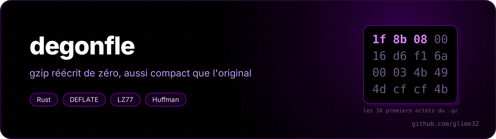

<p align="center"></p>

<p align="center"> </p>

A **gzip** compressor / decompressor written from scratch in Rust, with no dependencies: LZ77, Huffman codes, the DEFLATE format (RFC 1951) and the gzip container (RFC 1952). Its files decompress with the real `gzip`, and the other way round. (*Dégonfler* means "to deflate" in French.)

<p align="center"><a href="README.fr.md">🇫🇷 Version française</a></p>

```
$ cargo build --release
$ ./target/release/degonfle -v gros-fichier.txt          # -> gros-fichier.txt.gz
gros-fichier.txt : 7.7 Mo -> 1.2 Mo (15.7 %), 31.9 Mo/s, blocs : 38 dynamiques, 0 fixes, 0 non compressés
$ gzip -t gros-fichier.txt.gz && echo ok
ok
$ ./target/release/degonfle -d archive.gz
$ cat fichier | ./target/release/degonfle -9 > fichier.gz
```

Same options as gzip (`-d -c -f -v -1 … -9`, which can be grouped: `-dc`), except that the original file is never deleted.

## Against the real gzip

7.7 MB of text (random French words), on a laptop:

| | size | time |
|---|---|---|
| gzip -1 | 1,830,735 | 0.05 s |
| **degonfle -1** | **1,708,804** | 0.07 s |
| gzip -6 | 1,262,119 | 0.21 s |
| **degonfle -6** | **1,262,117** | 0.24 s |
| gzip -9 | 1,160,680 | 1.12 s |
| **degonfle -9** | **1,158,116** | 1.15 s |

Decompression runs at ~600 MB/s (gzip is a little faster).

`./verifier.sh` compresses and decompresses a set of files both ways with gzip (empty, one byte, zeros, random, text, source code, executable, two archives concatenated) and checks that everything comes back identical: 17 / 17.

## How it works

**LZ77.** Walk through the data and, at each position, look for the same bytes in the last 32 KB. If they're there, write "copy 12 bytes from 3,400 back" instead of the bytes. To find candidates quickly, each position is stored in a hash table keyed by its first 3 bytes, with positions sharing a hash chained together. Levels 1 to 9 set how far along the chain to go. Bytes are compared 8 at a time (the first differing byte comes from the trailing zeros of the XOR).

**Lazy matching.** Before accepting a match at `i`, check whether `i+1` offers a longer one. If so, write a single byte and take the next one. The per-level settings (chain length, "good enough", "lazy up to") come from zlib.

**Huffman.** The symbols (bytes, lengths, distances) are then encoded with variable-length codes: frequent ones in few bits. DEFLATE limits codes to 15 bits; a classic Huffman tree can be deeper, so the lengths are computed with the **package-merge** algorithm, which gives the optimal lengths under that limit. Only the lengths are sent (canonical code), themselves compressed with run lengths and then a small Huffman code.

**Three block types.** The stream is cut into blocks of 16,384 symbols. For each one, the exact cost in bits of the three ways to write it is computed (stored, the standard's fixed Huffman, Huffman built for this block), and the cheapest one is written. On random data, that gives stored blocks, and the file barely grows.

**Decompression.** Huffman codes are decoded with a 10-bit table (1,024 entries, which fits in cache): read 10 bits at once and the table gives the symbol and its real length. Longer codes, which are rare, go through bit-by-bit canonical decoding.

**CRC-32.** gzip checks integrity with a CRC. Computed byte by byte, it was the decompression bottleneck; the "slicing-by-8" version handles 8 bytes per round with 8 tables, and decompression went from 360 to 600 MB/s.

## Robustness

A damaged file must give an error, never a crash or wrong output. Tested on 600 copies of an archive with flipped bits or a truncated end: 600 clean errors ("code de Huffman invalide", "CRC incorrect", "données tronquées"...).
